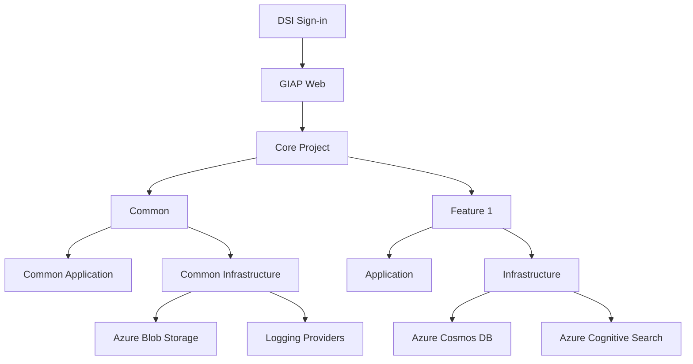

[](https://sonarcloud.io/summary/new_code?id=DFE-Digital_get-information-about-pupils)
[](https://sonarcloud.io/summary/new_code?id=DFE-Digital_get-information-about-pupils)
[](https://sonarcloud.io/summary/new_code?id=DFE-Digital_get-information-about-pupils)
[](https://sonarcloud.io/summary/new_code?id=DFE-Digital_get-information-about-pupils)
[](https://sonarcloud.io/summary/new_code?id=DFE-Digital_get-information-about-pupils)
[](https://sonarcloud.io/summary/new_code?id=DFE-Digital_get-information-about-pupils)
[](https://sonarcloud.io/summary/new_code?id=DFE-Digital_get-information-about-pupils)

| Tool   | StatusPage | Usage |
|--------|------------|-------|
| GitHub | <https://www.githubstatus.com> | Source code, GitHub actions for CI/CD |
| Azure | <https://status.azure.com> | CIP Infrastructure |
| NuGet | <https://status.nuget.org> | `dotnet` package restore |

# Get Information About Pupils

The Get Information About Pupils (GIAP) service allows education professionals to search
the [National Pupil Database](https://www.find-npd-data.education.gov.uk/) to retrieve pupil data.
GIAP is the replacement for the legacy service Key to Success (KtS).
It allows education professionals to search the National Pupil Database to retrieve pupil data,
and the following to access pupil-level census and attainment data:

- schools
- academies
- further education colleges
- academy trusts
- local authorities

GIAP also allows users to create and maintain their own custom lists of pupils,
making it easy to track the progress of specific groups or cohorts over time.

The service provides access to [pupil premium](https://www.gov.uk/government/publications/pupil-premium/pupil-premium)
funding allocation, helping schools effectively manage the financial aspects of new student enrolment from the start.

https://www.gov.uk/guidance/get-information-about-pupil-giap


## Getting Started / Setup

Read the [GIAP wiki](https://github.com/DFE-Digital/get-information-about-pupils-wiki)
  - [Onboarding](https://github.com/DFE-Digital/get-information-about-pupils-wiki/blob/main/runbooks/onboarding.md)
  - [Environments](https://github.com/DFE-Digital/get-information-about-pupils-wiki/blob/main/runbooks/environments.md)
  - [Deployment](https://github.com/DFE-Digital/get-information-about-pupils-wiki/blob/main/runbooks/deployments.md)
  - [ADRs](https://github.com/DFE-Digital/get-information-about-pupils-wiki/adr)

Prerequisites
- [Git](https://git-scm.com/downloads) (for getting a copy of the source code and contributing changes)
- [.NET 10 SDK](https://dotnet.microsoft.com/en-us/download/dotnet/10.0) (for building and running the C#/.NET web
application)
- [just](https://just.systems/man/en/) (for the repository's development commands)
- IDE/Editor of choice (e.g., Visual Studio, Visual Studio Code, JetBrains Rider, etc.)
- Local environment configured to authenticate to the GitHub NuGet feed
    - Create a classic [personal access token (PAT)](https://docs.github.com/en/authentication/keeping-your-account-and-data-secure/managing-your-personal-access-tokens) with `read:packages` scope from your GitHub account (fine-grained tokens [do not support package scopes](https://github.com/github/roadmap/issues/558)).
    - Add the NuGet source to your local environment by filling in the placeholders and running:
    ```sh
    dotnet nuget add source --username <YOUR_GITHUB_USERNAME> --password <YOUR_PERSONAL_ACCESS_TOKEN> --store-password-in-clear-text --name dfedigital "https://nuget.pkg.github.com/DFE-Digital/index.json"
    ```
Clone the repository
```sh
git clone https://github.com/DFE-Digital/get-information-about-pupils
```
Build the C#/.NET solution

The web artefacts (CSS, JS, fonts and images) are produced as part of the .NET build, so no
separate front-end tooling is required. [GovUk.Frontend.AspNetCore](https://github.com/x-govuk/govuk-frontend-aspnetcore)
restores the GOV.UK Frontend assets into `wwwroot/` and `lib/`, and
[AspNetCore.SassCompiler](https://github.com/koenvzeijl/AspNetCore.SassCompiler) compiles
`Styles/app.scss` into `wwwroot/css/app.css` (configured in `sasscompiler.json`). When running
in the `Local` environment the compiler also watches `Styles/*.scss` and recompiles on change.

```sh
## cd app/
dotnet build
```

Confirm tests are passing locally
```sh
## cd app/
dotnet test
```

Run the application
```sh
## cd app/src/DfE.GIAP.Web/
dotnet run
```

To run it with automatic rebuilds while editing, use `just watch-giap-web` from the
repository root. The command uses the web project's launch profile (`Local`).

### Sentry error logging

Set `Sentry__Dsn` as an Azure App Service setting for Production. The app requires it at startup in that environment. Sentry captures unhandled request exceptions and error logs from `ILogger`; Application Insights remains enabled. Sentry request body capture is disabled, and the request URL and query string fields are cleared because they can contain pupil data. Default PII collection and performance tracing are disabled.

Set `SENTRY_ENVIRONMENT` to distinguish deployments. The container image sets `SENTRY_RELEASE` from its `GIT_SHA` build argument; for App Service deployments, set `SENTRY_RELEASE` to the deployed commit SHA in the App Service settings if release tracking is needed.

Build the container image from the repository root using the authenticated NuGet
config from the prerequisites above. The `docker-build` recipe passes the config to
Docker as a build secret. The default `app/nuget.config` has no credentials, so set
`DOCKER_NUGET_CONFIG` to your authenticated config for a local build:

```sh
DOCKER_NUGET_CONFIG="$HOME/.nuget/NuGet/NuGet.Config" just docker-build \
  --build-arg GIT_SHA="$(git rev-parse HEAD)" \
  --tag giap:local
```

The packaging workflow builds this image alongside the existing web package, pushes
it to `ghcr.io/dfe-digital/get-information-about-pupils:<commit-sha>`, and verifies
that GHCR serves the tag. Fork and Dependabot pull requests build without pushing.
The image is not deployed to AKS.

If using Visual Studio, ensure the `DfE.GIAP.Web` project is set as the startup project and run it (F5 or use the
menu).


## Architecture

GIAP‑Web authenticates users through DSI, which provides both authentication and authorisation.
Once authenticated, the application interacts with the Core Project, which contains all feature logic and shared (common) functionality.

The Core Project delegates work to feature‑specific Application/Infrastructure layers and shared Common services.
Infrastructure components then communicate with Azure services such as Cosmos DB, Cognitive Search, and Blob Storage.



### Project dependencies

GIAP web has a number of dependancies listed below, some are closed source, others are open.

- .NET 10
- [GOV.UK Frontend for ASP.NET Core](https://github.com/x-govuk/govuk-frontend-aspnetcore) (GOV.UK Frontend assets)
- [AspNetCore.SassCompiler](https://github.com/koenvzeijl/AspNetCore.SassCompiler) (SCSS compilation)
- DSI (DfE sign-in)
- [Azure CosmosDb library](https://github.com/DFE-Digital/infrastructure-persistence-cosmosdb)
- [Azure AISearch library](https://github.com/DFE-Digital/infrastructure-cognitive-search)
- [DfE CleanArchitecture Application, Domain and CrossCutting libraries](https://github.com/DFE-Digital/cleanarch-crosscutting)

### Settings

Non-sensitive defaults are in `app/src/DfE.GIAP.Web/appsettings.json`. For local development,
store credentials and any environment-specific overrides in [.NET User Secrets](https://learn.microsoft.com/en-us/aspnet/core/security/app-secrets?view=aspnetcore-10.0)
using the web project's `UserSecretsId`. From the repository root, run `just set-secret`
with a configuration key and its value. Set the values you need for your local environment:

```sh
just set-secret RepositoryOptions:EndpointUri "<local Cosmos DB endpoint URI>"
just set-secret RepositoryOptions:PrimaryKey "<local Cosmos DB key>"
just set-secret AzureSearchConnectionOptions:EndpointUri "<local search endpoint URI>"
just set-secret AzureSearchConnectionOptions:Credentials "<local search key>"
just set-secret BlobStorageOptions:AccountKey "<local storage key>"
just set-secret DsiOptions:ServiceId "<local DSI service ID>"
just set-secret DsiOptions:ClientId "<local DSI client ID>"
just set-secret DsiOptions:ClientSecret "<local DSI client secret>"
just set-secret DsiOptions:ApiClientSecret "<local DSI API client secret>"
just set-secret DsiOptions:Audience "<local DSI audience>"
just set-secret DsiOptions:MetadataAddress "<local DSI metadata address>"
just set-secret DsiOptions:AuthorisationUrl "<local DSI authorisation URL>"
just set-secret DsiOptions:RedirectUrlAfterSignout "<local sign-out redirect URL>"
just set-secret DsiOptions:CallbackPath "<local sign-in callback path>"
just set-secret DsiOptions:SignedOutCallbackPath "<local sign-out callback path>"
just set-secret DsiOptions:SessionTimeoutMinutes "10"
```

Get the local values from the team through the [onboarding runbook](https://github.com/DFE-Digital/get-information-about-pupils-wiki/blob/main/runbooks/onboarding.md).
The command accepts any configuration key if another local setting needs an override.
`Local` and `Development` load User Secrets after JSON settings; environment variables override both.
For example, the environment variable for `DsiOptions:ClientSecret` is `DsiOptions__ClientSecret`.
Production uses Azure App Service settings. User Secrets are stored outside the repository but are
not encrypted; avoid putting real values in documentation or sharing your local secrets file.
Values supplied on a command line may also be retained in shell history.

## Continual Integration (CI)

`giap-web` has an [build pipeline](./github/ci.yml) which runs on each commit.

The solution depends on the DfEDigital GitHub Packages NuGet Feed.

## Logging

GIAP uses Application Insights for all auditing, warnings, and error logging.

This provides centralised telemetry across the application, making it easier to trace issues, monitor performance, and analyse user behaviour.

## License

Unless stated otherwise, the codebase is released under the MIT License. This covers both the codebase and any sample code in the documentation.

The documentation is © Crown copyright and available under the terms of the Open Government 3.0 licence
