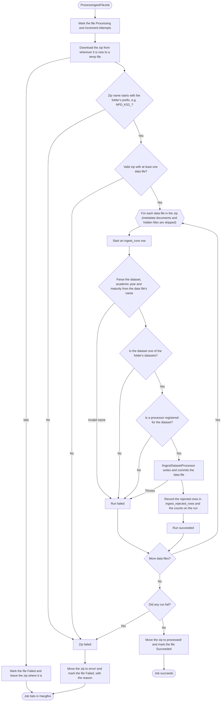

# File ingestion

> [!WARNING]
> The pipeline documented here isn't live in production yet. Until the switch-over, data files are still processed
> by the old Data Factory and Databricks pipeline.

The file ingestion job processes the zips of data files uploaded to the `ingest` blob container. It runs in the Worker
(`src/DfE.GIAP.Worker`) as Hangfire jobs; the code is in `src/DfE.GIAP.Core/Ingest` and `src/DfE.GIAP.Core/Jobs`.

## Container layout

Each dataset has a folder, matching the old pipeline's: `census`, `eyfsp`, `ks1`, `ks2`, `ks4`, `mtc`, `phonics`,
`pupil-premium`, `fe_pp` and `fe_sen`. Each folder has:

| Folder | Contents |
| --- | --- |
| `<dataset>/upload/` | Zips waiting to be processed |
| `<dataset>/processed/` | Zips that were processed successfully |
| `<dataset>/error/` | Zips that failed, and duplicate uploads |

A blob is never overwritten when it's moved. If the name is already taken, a UTC timestamp is added, e.g.
`NPD_KS2_2025_U.20261120T101500Z.zip`.

A zip is identified by its folder and name, e.g. `ks2/NPD_KS2_2025_U.zip`. This is the key of `ingest_files`.

## Finding uploads

`PollIngestUploadsJob` runs every minute. It lists every `<dataset>/upload/` folder and decides what to do with each
zip, oldest first:

## Processing a zip

`ProcessIngestFileJob` runs on the `ingest` queue, which has a single worker. A distributed lock means only one zip
is processed at a time, even with more than one Worker replica. Hangfire doesn't retry the job automatically.

Each data file is committed separately. A zip whose data files partly fail still keeps the data that was written.

## Replaying files

Processing a file again reprocesses every data file in it from wherever the zip is now. A zip that succeeds is moved
to `processed/` (or stays there), and one that fails is moved to `error/`. Dataset processors must be safe to run
again on the same file.

- **One file**: requeue its `ProcessIngestFileJob` from the Hangfire dashboard's failed or succeeded jobs.
- **Every failed file**: trigger the `requeue-failed-ingest-files` recurring job from the dashboard. It's never
  scheduled.
- **Fixing a failed upload**: upload a corrected zip with the same name to `upload/`.
- **Backfill**: upload the historical zips to `upload/`.

## What's recorded

| Table | One row per |
| --- | --- |
| `ingest_files` | Uploaded zip path: where the zip is now, its status, the reason it failed and the number of attempts |
| `ingest_runs` | Data file per attempt: dataset, academic year, maturity, record counts, start/end times, status and error |
| `ingest_rejected_rows` | Row a dataset processor rejected: its row number, values and the reasons |
