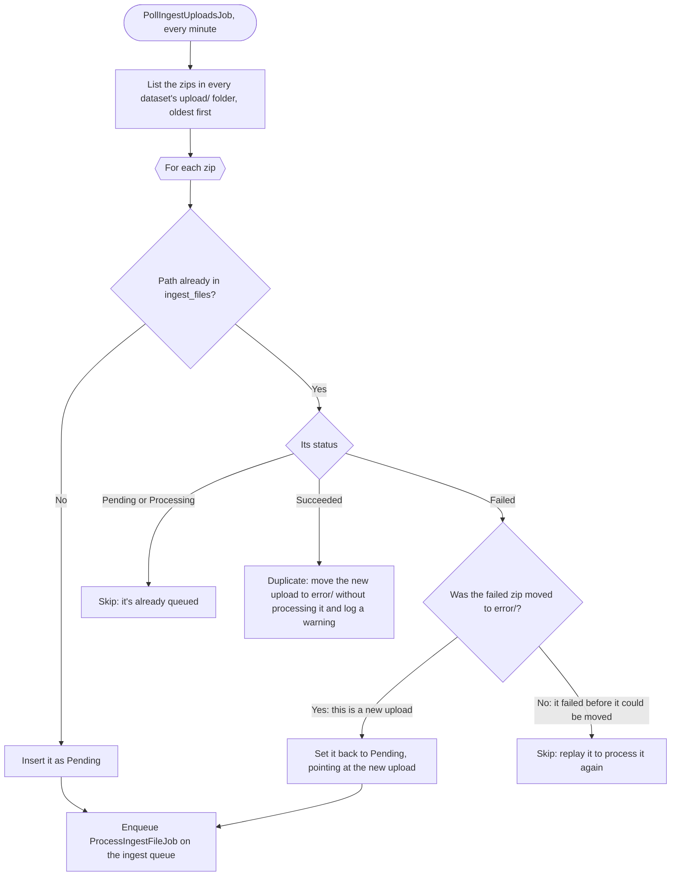
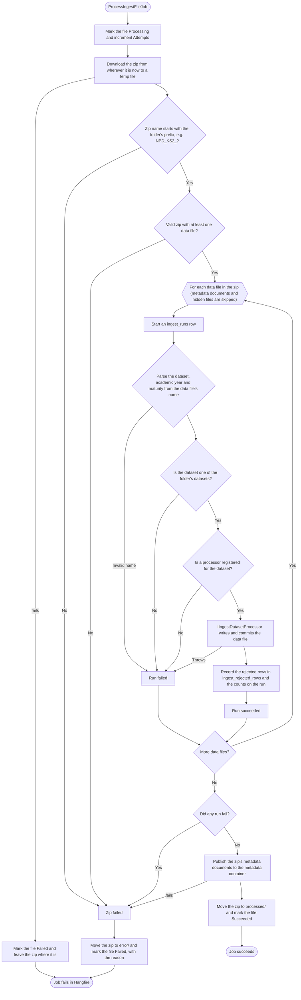

# File ingestion

> [!WARNING]
> The pipeline documented here isn't live in production yet. Until the switch-over, data files are still processed
> by the old Data Factory and Databricks pipeline.

The file ingestion job processes the zips of data files uploaded to the `ingest` blob container. It runs in the Worker
(`src/DfE.GIAP.Worker`) as Hangfire jobs; the code is in `src/DfE.GIAP.Core/Ingest` and `src/DfE.GIAP.Core/Jobs`.

## Container layout

Each dataset has a folder, matching the old pipeline's: `census`, `eyfsp`, `ks1`, `ks2`, `ks4`, `mtc`, `phonics`,
`pupil-premium`, `fe_pp` and `fe_sen`. Each folder has:

| Folder | Contents |
| --- | --- |
| `<dataset>/upload/` | Zips waiting to be processed |
| `<dataset>/processed/` | Zips that were processed successfully |
| `<dataset>/error/` | Zips that failed, and duplicate uploads |

When a zip is moved, the UTC time it was moved is added to its name, e.g. `NPD_KS2_2025_U.20261120T101500Z.zip`, so
every upload of a zip is kept. A blob is never overwritten.

A zip is identified by its folder and name, e.g. `ks2/NPD_KS2_2025_U.zip`. This is the key of `ingest_files`.

## Finding uploads

`PollIngestUploadsJob` runs every minute. It lists every `<dataset>/upload/` folder and decides what to do with each
zip, oldest first:

## Processing a zip

`ProcessIngestFileJob` runs on the `ingest` queue, which has a single worker. A distributed lock means only one zip
is processed at a time, even with more than one Worker replica. Hangfire doesn't retry the job automatically.

Each data file is committed separately. A zip whose data files partly fail still keeps the data that was written.

## Metadata documents

Zips usually contain documents alongside the data files that describe the dataset, such as its columns and the codes
used in them. Any `.xlsx`, `.doc` or `.docx` file in a zip is a metadata document; it isn't processed as a data file.

Users read these documents on the Glossary page (`GlossaryController`), which lists them newest first and lets users
download them. It currently lists the documents the old pipeline publishes to `AllUsers/Metadata/` in the
`giapdownloads` container of the old downloads storage account. When the new pipeline goes live, the Glossary page
will need to read from the new pipeline's `metadata` container instead.

Once every data file in a zip has succeeded, `IngestMetadataPublisher` copies the zip's metadata documents to the
`metadata` container, in the same storage account as the `ingest` container. They're named as they are in the zip,
without any folders. A document with the same name as one that's already there replaces it, as it did in the old
pipeline. Hidden files such as macOS's `__MACOSX/` and `._` files are skipped.

- A zip with a failed data file doesn't publish its documents.
- If publishing a document fails, the zip fails and is moved to `error/`. The data files have already been committed.
- Replaying a zip publishes its documents again.

## NPD datasets

`NpdDatasetProcessor` (in `src/DfE.GIAP.Core/PupilData`) processes the NPD data files: census (autumn, spring and
summer), EYFSP, phonics, KS1, KS2, KS4 and MTC. It replaces the old pipeline's `data_update_pipeline` notebook, and
writes to `npd_pupil_records` and `npd_pupils` through `NpdDataWriter`.

### Reading the file

Data files are always read as tab-separated UTF-8, whatever their extension, with `"` quoting. Each dataset's
identifying columns (PupilMatchingRef, LA, Estab, URN, UPN, surname, forename, middle names (census only), sex, DOB and
academic year) are listed in `NpdDatasetDefinition`, ported from the old pipeline's `dictionary_mapping_to_master`.
Column names are matched case-insensitively.

Every column in a row is stored in the record's `data`, not just the identifying ones:

- Values are trimmed and stored as strings exactly as they are in the file. An empty value is `null`; anything else,
  including the text `NULL`, is kept.
- Dots in column names are replaced with underscores, as the old pipeline did.
- `DOB`, and `EntryDate` if the file has it, are written as `yyyy-MM-ddT00:00:00.000Z`. An `EntryDate` that isn't a
  valid date is written as `null`.
- A row with no academic year keeps `null` in `data`, but its record is stored under the file's academic year.

A pupil with more than one row in a file (e.g. a dual-registered pupil in the census) gets a single record whose `data`
is an array of their rows in file order. The record's identifying fields come from their first row.

### Dates

Dates must be `yyyy-MM-dd` (optionally with a time) or day-first `dd/MM/yyyy` (optionally with a time). The old
pipeline parsed slashed NPD dates month-first, so `01/02/2015` was 2 January; it's now 1 February.

### Rejected rows and failed files

| Problem | Outcome |
| --- | --- |
| The file is empty, or is missing one of the dataset's identifying columns | The data file fails |
| The file has two columns with the same name | The data file fails |
| A row has no PupilMatchingRef | The row is rejected |
| A row's DOB isn't a valid date | The row is rejected |
| A row's academic year isn't the one in the file's name | The row is rejected |
| Every row is rejected, or there are no rows | The data file fails, with the first rejected row's reasons |
| The stored data for the dataset and academic year is from a more mature file | The data file fails |

Rejected rows are recorded in `ingest_rejected_rows`. There's no limit on how many rows can be rejected.

### Writing the records

A data file replaces all the records for its dataset and academic year:

- Files are ranked by maturity: unamended (`U`, or no maturity in the name), then amended (`A`), then final (`F`). A file
  is written if it's at least as mature as the data stored for its dataset and academic year.
- A pupil that has a record for the dataset and academic year but isn't in the file loses that record, and a pupil
  left with no records is removed.
- The identifying fields on `npd_pupils` come from a census record if the pupil has one, then from the latest academic
  year, then from the record that was loaded first.

The rows are streamed into a temporary table and combined in Postgres, so a whole census file is never held in memory.
Writing the same file again leaves the same data, so replaying a file is safe.

## Replaying files

Processing a file again reprocesses every data file in it from wherever the zip is now. A zip that succeeds is moved
to `processed/` (or stays there), and one that fails is moved to `error/`. Dataset processors must be safe to run
again on the same file.

- **One file**: requeue its `ProcessIngestFileJob` from the Hangfire dashboard's failed or succeeded jobs.
- **Every failed file**: trigger the `requeue-failed-ingest-files` recurring job from the dashboard. It's never
  scheduled.
- **Fixing a failed upload**: upload a corrected zip with the same name to `upload/`.
- **Backfill**: upload the historical zips to `upload/`.

## What's recorded

| Table | One row per |
| --- | --- |
| `ingest_files` | Uploaded zip path: where the zip is now, its status, the reason it failed and the number of attempts |
| `ingest_runs` | Data file per attempt: dataset, academic year, maturity, record counts, start/end times, status and error |
| `ingest_rejected_rows` | Row a dataset processor rejected: its row number, values and the reasons |
